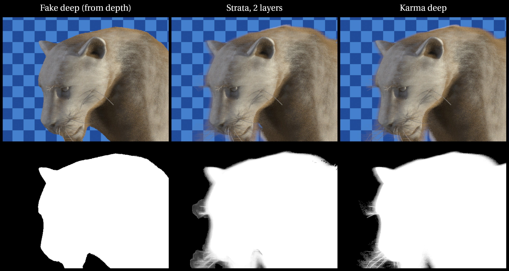

# Strata

Strata is a research project by Biohazard VFX. The goal is to get deep data, a solved camera and per-layer PBR materials straight out of live-action footage, inside the tools compositors already use.

Today, a holdout through hair, fur, motion blur or defocus means roto or a hard, chewed depth matte. Deep keeps several samples per pixel, each with its own depth, colour and coverage. Strata predicts it from the plate.

*A CG card behind a creature the model never saw in training. Bottom row: holdout matte.*

On early tests with a small dataset, a post-trained Depth Pro 2 already produces coherent deep data. We're now scaling the dataset up.

## Status

| | Status |
|---|---|
| Runtime: C library and command-line tool (CPU and NVIDIA GPU) | Done |
| Synthetic training data: Houdini/Karma shots with rendered deep ground truth | Done |
| Strata 1 training | In progress |
| Nuke node (native deep) | Planned |
| OFX and ComfyUI | Planned |
| Desktop app | Planned |

## Models

| | Input | Output | Base model | Use |
|---|---|---|---|---|
| Strata 1 | Video | Deep | Apple Depth Pro 2 | Research and testing |
| Strata 2 | Video | Deep, solved camera, early PBR | Apple Depth Pro 2 | Research and testing |
| Strata 3 | Video | Deep, solved camera, PBR | Meta DINOv3 | Commercial work |

## FAQ

**Do I need to train it on my own footage?**
No.

**Is it open source?**
Source-available under the Elastic License 2.0: use and modify it in your pipeline, commercial work included, but don't sell it as a hosted service. Weights are licensed per model (see Models).

**Which apps will it run in?**
Nuke first, with native deep. Then OFX hosts and ComfyUI.

## For developers

| Folder | What's in it |
|---|---|
| `runtime/` | C library, `strata` CLI and `strata_bench`, on ONNX Runtime. [Build and usage](runtime/README.md). |
| `training/` | Model export, post-training and evaluation. |
| `datagen/` | Synthetic dataset generation: USD and MaterialX scenes rendered in Karma, with deep, cameras and material AOVs per frame. |
| `contract/` | The versioned model and dataset specs shared by the other folders. |
| `tools/` | Repository checks. |

`strata depth` requires `--in-colorspace acescg|aces2065-1|lin-rec709|lin-rec2020`. Model input converts to ACEScg; deep colours stay in the declared plate space.

Host plugins will live in `hosts/` and use only the public C API.

## References

- Bochkovskii et al., *Depth Pro: Sharp Monocular Metric Depth in Less Than a Second*, 2024. [arXiv:2410.02073](https://arxiv.org/abs/2410.02073)
- Hu et al., *Depth Pro 2: Sharp and Temporally Consistent Metric Monocular Depth*, 2026. [arXiv:2611.26603](https://arxiv.org/abs/2611.26603)
- Burzio, Fischer et al., *Déjà View: Looping Transformers for Multi-View 3D Reconstruction*, 2026. [arXiv:2605.30215](https://arxiv.org/abs/2605.30215)

BibTeX is in [`CITATION.bib`](CITATION.bib).

## License

Code: Elastic License 2.0. Contributions require the CLA ([CONTRIBUTING.md](CONTRIBUTING.md)).

Strata is part of Materia by Biohazard VFX.
